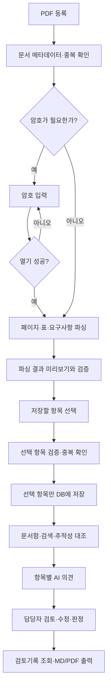

# GEO-KSAT-X 문서분석·추적성 검토 도구 설계문서

- 상태: 검토용 설계 초안
- 작성일: 2026-11-12
- 목적: 설계 검토와 범위 확정
- 구현·Git 업로드·배포: 이 문서 검토 후 진행
- 참고 목업: [`개인툴_개념도_화면목업.html`](개인툴_개념도_화면목업.html)
- 검토 기준 초안: [`skill_review.md`](skill_review.md)

## 1. 목적과 범위

GEO-KSAT-X와 같은 시스템 공학 문서를 PDF로 등록하고, 파싱 결과를 확인한 뒤 필요한 항목만 선택해 저장한다. 저장된 요구사항과 검증 자료를 검색·대조하고, AI 의견과 담당자 검토기록을 항목별로 관리한다.

초기 배포는 UI와 가상 데이터로 기능을 확인하기 위한 임시 단계다. 최종 운영은 인터넷이 차단된 내부 환경에서 문서와 데이터가 외부로 나가지 않도록 하고, AI는 내부 Ollama만 사용한다.

이번 초안에서 다루는 핵심 범위는 다음과 같다.

- PDF 문서함, 파싱 미리보기, 사용자가 선택한 결과만 저장
- 암호가 설정된 PDF를 위한 암호 입력·처리 설계
- 문서함·추적성 상세 패널의 너비 조정
- 문서·요구사항 검색, 추적성 대조, 항목별 AI 의견 및 사람의 검토기록
- 임시 Git/Vercel 단계와 최종 폐쇄망/Ollama 단계의 분리

스캔 PDF의 OCR, 여러 사용자의 동시 편집, 세부 권한 체계, 전자결재는 별도 범위로 둔다. GEO-KSAT-X의 현재 자료는 샘플이며, 스캔 PDF나 암호 PDF 처리 성능을 입증하지 않는다.

## 2. 배포 단계

| 단계 | 목적 | 실행 환경 | 자료·AI 정책 |
|---|---|---|---|
| 0. 설계 검토 | 범위와 보안 기준 확정 | 현재 문서와 목업 | 코드 변경 없음 |
| 1. 임시 시연 | UI·업무 흐름 확인 및 제한된 시연 | 전용 Git 저장소와 Vercel | 시연 시작 전 가상 자료 전체를 한 번에 준비해 문서함에 미리 등록. 실문서·암호 PDF·실제 검토기록·운영 비밀값은 사용하지 않음. AI 외부 API를 연결할 경우 가상 자료만 전송 |
| 2. 폐쇄망 운영 | 실제 문서 분석과 검토 | 내부 서버 또는 내부 노트북 | 로컬 파일 저장소와 SQLite/FTS5, 내부 Ollama. 외부 API·CDN 호출 없음 |

### 임시 Git/Vercel 단계 권고

1. 이 작업 폴더에는 다른 도구와 자료가 함께 있으므로, 구현을 시작할 때 문서 분석 도구 전용 하위 폴더/저장소를 만든다. 배포 루트에는 해당 도구만 포함한다.
2. Git에는 소스, 가상 자료, 문서화된 설정 예시만 올린다. 실제 PDF, 파싱 결과, DB, 비밀번호, API 키, `.env` 파일은 저장소에서 제외한다.
3. 첫 시연은 가상 자료 일괄 사전 적재 방식으로 시작한다. GEO-KSAT-X의 허용된 가상 PDF와 샘플 메타데이터를 배포 전 준비해 문서함에 모두 표시하고, 사용자는 개별 파일을 하나씩 업로드하는 단계 없이 바로 문서 확인·파싱 결과 수정·선택 저장을 시연한다. 파싱 결과도 시연용 데이터로 사전 준비해 첫 화면부터 확인할 수 있게 한다. 시연 초기 상태는 파싱 후보가 검토 대기이고 저장되지 않은 상태로 둔다.
4. 시연 데이터는 초기화할 수 있는 고정 fixture로 관리한다. `데모 데이터 초기화`는 문서함·파싱 후보·AI 예시 의견·사람 검토 예시를 일관된 시작 상태로 되돌리며, 사용자가 추가하거나 수정한 데모 상태를 초기화 전에 안내한다.
5. 이 시연 단계에서는 실제 문서 업로드·저장을 연결하지 않는다. 나중에 업로드 시연이 필요하면 별도 승인과 데이터 보관·삭제 정책을 먼저 확정한다.
6. Vercel Function의 요청·응답 본문은 최대 4.5 MB이므로 PDF를 Function 본문에 직접 전송하는 설계는 피한다. 사전 적재 가상 자료를 사용하는 시연에는 런타임 PDF 업로드가 필요하지 않다. [Vercel Function 제한](https://vercel.com/docs/functions/limitations)
7. 비공개 Blob은 인증된 읽기를 제공하지만, 클라우드에 문서를 저장하는 구성이 된다. 설계 검토에서 실제 업로드가 승인되지 않는 한 시연에 사용하지 않는다. [Vercel 비공개 Blob](https://vercel.com/docs/vercel-blob/private-storage)
8. OpenAI/Claude API는 임시 시연에서만 선택적으로 연결한다. 호출은 서버 측 어댑터를 통하고 키는 Secret 환경 변수로 관리하며, 키를 브라우저 코드나 Git에 넣지 않는다. Vercel Secret 변수는 민감값 관리 기능이지 문서 외부 전송을 막는 기능은 아니다. [Vercel 환경 변수](https://vercel.com/docs/environment-variables) · [Config/Secret 유형](https://vercel.com/changelog/environment-variables-now-use-config-and-secret-types)
9. Vercel 배포 환경은 개인 노트북에서 실행 중인 Ollama에 직접 접근할 수 없으므로, 임시 클라우드 시연과 최종 내부 Ollama 운영은 별도 배포 설정으로 분리한다.

### 최종 폐쇄망 단계 권고

- 웹 UI와 API, 원본 PDF, SQLite 데이터베이스, Ollama를 내부 네트워크에서 실행한다.
- PDF 원본은 접근 권한이 제한된 내부 폴더에 두고, DB에는 문서 메타데이터·파싱 항목·검토기록과 내부 저장 경로를 둔다.
- 검색은 임베딩 없이 SQLite FTS5 전문검색과 정확한 ID/문서번호 검색을 사용한다.
- Ollama 호출은 내부 주소만 허용한다. OpenAI/Claude 제공자 설정과 외부 네트워크 호출은 배포 설정에서 비활성화한다.
- 백업과 복구도 내부 저장 장치에서 수행한다. 외부 Git에는 소스와 가상 샘플만 올린다.

## 3. 주요 사용자 흐름

파싱 결과는 저장 전까지 임시 상태로 유지한다. 사용자는 파싱값을 확인하고 수정한 뒤 저장 대상을 선택할 수 있다. 검색, 추적성 대조, AI 의견 생성은 저장된 항목만 대상으로 한다. 선택하지 않았거나 파싱 오류가 있는 항목이 저장된 것처럼 취급되지 않도록 저장 전후 건수를 표시한다.

## 4. 문서함 파싱·선택 저장

### 시연 시작 시 초기 데이터

- 시연 환경을 배포하기 전에 준비한 전체 가상 문서 세트를 한 번에 등록한다. 현재 샘플 범위에 맞춰 문서함에는 37개 PDF와 총 468쪽 규모의 자료가 준비된 모습으로 표시한다.
- 문서 메타데이터와 파싱 후보는 시연 fixture로 미리 적재한다. 시연 첫 실행에서 매번 전체 PDF를 다시 파싱하지 않아도 되도록 하며, 파싱 대기/완료 결과와 저장 대기 상태를 미리 보여준다.
- 모든 후보를 저장 대기 상태로 시작하고, 사용자가 일부 항목의 내용을 수정한 뒤 원하는 것만 선택해 저장하는 흐름을 시연한다. 샘플의 914개 정답 파일 항목과 TBD/TBR 사례 등은 관련 문서·추적 대조 화면에서 확인할 수 있게 연결한다.
- 개별 PDF 등록과 재파싱 기능은 후속 실제 구현 범위로 유지한다. 사전 적재는 사용자가 업로드한 것으로 오인하지 않도록 `시연용 가상자료` 표시를 상시 노출한다.

### 화면과 상호작용

1. 문서함에서 PDF를 등록하면 문서명, 문서번호, 개정번호, 페이지 수, 파일 크기, 파일 해시, 등록 시각, 처리 상태를 표시한다.
2. 사용자가 문서를 선택하면 오른쪽 상세 패널이 왼쪽에서 열리고, 문서 정보·페이지 미리보기·파싱 결과·저장 상태를 확인한다.
3. 파싱이 끝나면 결과를 ID, 구분, 페이지, 내용, 파싱 상태 열로 보여준다. 긴 요구사항 본문은 행에서 일부를 보여주고 펼쳐서 전체 내용을 확인할 수 있다.
4. 각 결과를 행 안에서 편집하거나 상세 편집 창에서 수정할 수 있다. 문서/요구사항 ID, 제목, 본문, 유형, 페이지·절 위치, 상·하위 ID와 검증 방법 등 구조화된 필드를 편집 대상으로 한다. 원문 페이지를 함께 열어 대조할 수 있게 한다.
5. 사용자가 수정한 값은 파싱 원본과 분리해 임시 수정값으로 보관한다. `원본과 수정값 비교`, `수정 취소`, `원본으로 되돌리기`를 제공한다. 저장할 때는 수정값을 저장하고, 원본 추출값은 파싱 작업 이력에서 확인할 수 있도록 남긴다.
6. 편집 중 형식 오류나 필수값 누락을 즉시 표시한다. 예를 들어 ID 중복, 페이지 범위 오류, 잘못된 상·하위 연결 형식을 알려주되, 검토자가 해결하기 전까지 해당 후보를 선택 저장할 수 없게 한다. 원문과 다른 수정 자체를 오류로 간주하지 않고, 수정 내용이 원문에 근거하도록 페이지/절 출처를 확인할 수 있게 한다.
7. 각 결과 행에 선택 체크박스를 제공한다. 기본값은 모두 미선택이다. `전체 선택`, `선택 해제`, 오류/중복 제외 필터를 제공한다. 선택 상태와 편집 상태는 별도로 표시한다.
8. 저장 전 선택 건수, 수정된 건수, 저장 대상 유형을 확인한다. 저장 성공·중복 제외·실패 건수를 결과로 보여주고 실패 항목은 원인을 표시한다.
9. 문서 목록에는 `미등록`, `파싱 중`, `수정/선택 대기`, `일부 저장`, `저장 완료`, `오류` 상태를 제공한다. 파싱 완료만으로 문서의 모든 결과가 저장됐다고 표시하지 않는다.

### 저장 규칙

- 선택된 정상 항목만 한 번의 저장 작업으로 반영한다. 선택 항목을 검증한 후 가능한 한 트랜잭션으로 저장한다.
- 사용자가 편집한 항목은 원본 추출값과 수정값을 구분해 보관한다. 저장 시에는 검증을 통과한 수정값을 반영하고, 수정 전 원본값과 변경 이력을 파싱 작업 기록에 연결한다.
- 수정 여부와 선택 여부는 별개다. 수정했더라도 선택하지 않은 항목은 본 저장 데이터에 반영하지 않는다.
- 저장 식별 키는 `(문서 ID, 개정번호, 항목 유형, 항목 ID)` 조합을 기본으로 한다.
- 동일 키가 이미 있으면 기본 동작은 건너뛰기다. 기존 값을 자동 덮어쓰지 않는다. 교체 기능은 기존/신규 내용 비교와 사용자 확인을 거친다.
- 파싱 결과는 저장 전에는 임시 작업 데이터이며, 저장 성공한 항목만 추적성 검색·AI 문맥에 포함한다.
- 원본 PDF 삭제와 파싱 항목 삭제는 서로 다른 동작으로 두고, 삭제 전에 영향 범위를 알린다.
- 각 저장 작업에 작업 ID, 사용자/담당자(사용자 인증이 추가된 경우), 시각, 성공·실패 수, 교체 여부를 기록한다. 비밀번호는 기록하지 않는다.

## 5. 암호 PDF 처리

암호 입력은 추후 기능으로 구현하되, 데이터 흐름을 처음부터 분리한다.

- PDF가 암호화되어 있으면 상태를 `암호 입력 필요`로 표시하고 해당 문서의 암호 입력 UI를 연다.
- 암호는 파싱 작업에만 메모리로 전달한다. DB, 로그, 브라우저 저장소, Git, URL, 분석 이벤트에 기록하지 않는다.
- 파싱 성공·실패·취소 시 암호 참조를 즉시 폐기한다. 기본 동작은 암호를 기억하지 않는 것이다.
- 틀린 암호에는 재입력 기회를 주고, 재시도 횟수와 오류 상태를 표시한다. 암호 취소 시 문서를 `암호 입력 취소`로 남기고 다른 문서 파싱은 계속할 수 있게 한다.
- 손상 파일, 미지원 암호 방식, 파서 오류는 암호 오류와 구분해 안내한다.
- 클라우드 시연에서 업로드를 나중에 허용하더라도 실제 암호 PDF는 사용하지 않는다. 업로드된 파일과 입력한 암호가 사용자 장치 밖의 서비스에 전달되기 때문이다.
- 내부 운영에서 기억 기능이 필요해지면 OS 자격 증명 저장소 도입을 별도 검토한다. 암호를 일반 설정이나 SQLite에 저장하는 방식은 채택하지 않는다.

## 6. 상세 패널 크기 조정

문서함과 추적성 대조 화면의 오른쪽 상세 패널은 현재 목업의 넓은 레이아웃을 기준으로, 왼쪽 경계를 드래그해 너비를 바꿀 수 있게 한다.

| 항목 | 설계안 |
|---|---|
| 기본 너비 | 화면 너비의 약 82%, 최대 980px (현재 목업 기본값과 일관) |
| 최소/최대 | 데스크톱 최소 560px, 최대 `95vw` |
| 조작 | 왼쪽 경계 드래그, `좁게`/`넓게`/`기본 크기` 버튼 |
| 접근성 | 크기 조절 손잡이에 키보드 포커스 제공, 화살표 키로 너비 변경, 명확한 이름과 현재 너비 안내 |
| 모바일 | 패널 너비 96vw, 드래그 대신 넓게/기본 크기 조작도 제공 |
| 저장 | 너비 값만 브라우저의 UI 설정으로 저장 가능. 문서 내용이나 암호는 브라우저 저장소에 두지 않음 |

기존의 닫기, 뒤로가기, Escape, 바깥 영역 클릭 동작을 유지한다. 확대된 패널에서도 문서 ID뿐 아니라 전체 요구사항 내용, 페이지 출처, 상·하위 연결과 검토 의견을 읽을 수 있도록 본문 영역을 확보한다.

## 7. 문서·데이터 구조

| 데이터 | 핵심 필드 | 저장 위치/주의 |
|---|---|---|
| Document | ID, 문서번호, 이름, 유형, 개정, 날짜, 페이지 수, 파일 해시, 내부 파일 경로, 상태 | 메타데이터는 SQLite, PDF는 보호된 파일 폴더 |
| ParseJob | 작업 ID, 문서 ID, 시작/완료 시각, 파서 버전, 상태, 후보/오류 건수 | 암호 값은 필드로 두지 않음 |
| ParseCandidate | 후보 ID, 작업 ID, 항목 유형, 원본 추출 필드, 수정 필드, 변경 여부, 페이지/절, 검증 상태, 선택 여부 | 저장 전 임시 결과. 원본 추출값은 보존하고 수정값·선택 상태를 별도로 관리 |
| TraceItem | 문서 ID, 개정, 유형, ID, 제목, 전체 본문, 근거 위치, 상위/하위 ID, 검증 방법 | 저장 확인된 항목만 검색·추적성 기능에 사용 |
| AIReview | 추적 항목 ID, 제공자/모델, 검토 기준 버전, 의견, 근거, 생성 시각 | 초안 의견. 사람의 판정과 별도 보관 |
| HumanReview | 추적 항목 ID, 담당자, 판정, 검토 의견, 수정 시각 | 담당자 검토의 최종 기록 |

요구사항 ID와 본문뿐 아니라 페이지/절 근거를 함께 보관해 AI 의견 및 담당자 판단의 출처를 추적할 수 있게 한다. 상위/하위 연결이 없다는 이유만으로 자동 오류 판정하지 않고 문서 계층과 적용성에 따른 검토 질문을 만든다. 상세 기준은 `skill_review.md`를 기준으로 관리한다.

## 8. 검색·AI·담당자 검토

- 검색은 임베딩 없이 문서번호, 개정, 항목 ID, 본문 키워드, 문서 유형을 지원한다. 내부 운영의 본문 검색은 SQLite FTS5를 우선 사용한다.
- 추적성 대조는 문서 유형, ID/본문 검색, 상위·하위 연결 상태, 검토 상태로 필터링한다.
- Ollama 의견은 한 추적 항목 단위로 생성하며, 해당 항목의 본문, 연결된 상·하위 항목, 근거 페이지, 관련 검토 기준만 문맥으로 전달한다.
- AI 결과는 사람의 판정을 대신하지 않는다. 담당자는 채택·수정·기각하고 근거 의견을 남긴다. 전체 추적 검토 현황은 별도 현황 화면에서 집계한다.
- 임시 단계의 제공자 추상화는 `Ollama`, `OpenAI API`, `Claude API`를 선택할 수 있도록 설계하되 외부 제공자는 가상 자료 시연으로 제한한다. 제공자별 연결 여부와 모델은 화면에 분명히 표시한다.
- 최종 폐쇄망 빌드에서는 Ollama만 활성화한다. 외부 API 키 설정 화면과 외부 연결 코드는 구성으로 비활성화하거나 별도 배포 프로파일에서 제외한다.

## 9. 모듈/API 경계 초안

실제 구현 시 프런트엔드에서 데이터 저장소나 AI 제공자를 직접 호출하지 않고 다음 경계로 나눈다.

| API 초안 | 역할 |
|---|---|
| `POST /api/documents` | 파일 등록 및 문서 메타데이터 생성 |
| `POST /api/documents/{id}/parse` | 파싱 시작. 암호 PDF인 경우 암호는 해당 요청의 보호된 본문으로만 전달 |
| `GET /api/parse-jobs/{id}` | 파싱 상태와 후보 목록 조회 |
| `PATCH /api/parse-jobs/{id}/candidates/{candidateId}` | 후보의 수정 필드 반영. 원본 추출 필드는 보존하고 수정값 검증 |
| `PATCH /api/parse-jobs/{id}/selection` | 선택된 후보 ID만 갱신 |
| `POST /api/parse-jobs/{id}/save` | 선택 항목 검증·중복 확인·저장 |
| `GET /api/trace-items` | 검색·필터 조건에 맞는 저장 항목 조회 |
| `POST /api/trace-items/{id}/ai-review` | 해당 항목의 AI 의견 생성 |
| `POST /api/trace-items/{id}/human-review` | 담당자 판정과 검토 의견 저장 |

저장 요청에는 중복 제출을 막는 작업 ID/멱등 키를 사용한다. API 응답은 후보 수, 선택 수, 신규 저장 수, 중복 수, 실패 수를 구분한다. 암호는 API 경로·작업 상태 조회 응답·오류 로그에 포함하지 않는다.

## 10. 비기능 요구사항과 초기 수용 기준

| ID | 기준 |
|---|---|
| NFR-01 | 기본 선택 상태에서 저장하면 0건이 저장되고 이를 명확하게 안내한다. |
| NFR-02 | 일부 후보만 선택해 저장하면 선택한 정상 후보만 저장되고, 나머지는 검색·AI 문맥에 나타나지 않는다. |
| NFR-03 | 동일 문서/개정/유형/ID 중복 저장은 자동 덮어쓰기하지 않는다. |
| NFR-04 | 파싱 후보의 필드를 수정하고 원본 추출값과 수정값을 비교·복구할 수 있다. |
| NFR-05 | 수정했지만 선택하지 않은 후보는 저장되지 않는다. 저장 시 유효성 검사를 통과한 수정값이 반영된다. |
| NFR-06 | 암호 PDF 암호가 저장소·로그·브라우저 영구 저장소에 남지 않는다. |
| NFR-07 | 상세 패널을 최소·최대 범위 안에서 조절할 수 있고 전체 본문을 확인할 수 있다. |
| NFR-08 | 임시 데모의 Git 저장소에는 실제 PDF·DB·암호·API 키가 포함되지 않는다. |
| NFR-09 | 최종 내부 실행에서 외부 네트워크 연결 없이 검색·파싱·Ollama 의견 기능을 사용할 수 있다. |
| NFR-10 | 문서별 파싱 오류·저장 실패·AI 실패를 성공 상태와 구분해 보여준다. |
| NFR-11 | Vercel 시연은 전체 가상 문서·파싱 후보가 미리 적재된 상태에서 시작하고, 데모 초기화 후 동일한 시작 상태를 복구한다. |

## 11. 구현 순서 제안

1. 본 설계와 적용 범위를 검토·확정한다.
2. 문서 분석 도구 전용 프로젝트/저장소를 분리하고 목업 화면 구조를 실제 UI로 옮긴다.
3. 가상 자료 문서함, 선택 저장, 검색/추적성 대조, 검토기록을 로컬 저장소 기준으로 구현한다.
4. 비밀번호 입력을 포함한 PDF 파싱 작업 상태 흐름을 구현한다. 암호 비보관 원칙을 먼저 적용한다.
5. Ollama 로컬 어댑터를 연결하고 `skill_review.md`를 검토 기준 문맥으로 적용한다.
6. 전용 저장소에 안전 점검된 소스와 가상 샘플만 올리고, 임시 Vercel 시연은 가상 자료 기능으로 제한한다.
7. 폐쇄망 환경에서 외부 통신 차단 상태로 설치·백업·복구 및 기능을 확인한다.

## 12. 검토가 필요한 기본 결정

다음은 이 설계의 권장 기본값이며, 검토 중 변경할 수 있다.

- 파싱 후보는 기본 미선택으로 하고, 사람이 선택한 항목만 저장한다.
- 파싱 항목은 저장 전에 수정할 수 있고, 원본 추출값과 수정값을 함께 확인할 수 있다.
- 중복 항목은 기본 건너뛰며 자동 덮어쓰지 않는다.
- 암호는 한 파싱 작업 동안만 사용하고 저장·기억하지 않는다.
- Vercel 시연은 가상 자료 기반으로 하며 실 PDF 업로드/저장은 포함하지 않는다.
- Vercel 시연 시작 전 전체 가상 문서와 파싱 후보를 사전 적재하고, 사용자가 수정·선택 저장을 바로 시연하도록 한다.
- 상세 패널은 데스크톱에서 560px~95vw 범위, 모바일 96vw를 기본으로 한다.
- 최종 운영은 내부 Ollama만 사용하고 외부 API 제공자는 끈다.
- OCR은 별도 샘플과 정확도 평가가 준비된 뒤 추가한다.

## 13. 다음 세션 구현 인수인계

다음 세션에서는 이 설계문서를 기준 문서로 삼고, 사용자 검토로 바뀐 항목을 먼저 반영한 뒤 구현을 시작한다. 현재 작업 폴더에는 다른 프로젝트 파일도 있으므로 저장소 루트에 섞어 배포하지 말고, 문서 분석 도구 전용 하위 폴더와 Git 저장소를 만든다.

### 구현 착수 순서

1. 이 설계문서, [`개인툴_개념도_화면목업.html`](개인툴_개념도_화면목업.html), [`skill_review.md`](skill_review.md), `GEO-KSAT-X/README.txt`를 읽고 데이터 범위와 가상 자료 허용 범위를 확인한다.
2. 전용 프로젝트 구조를 만들고 Vercel 정적 시연 화면부터 구성한다. 초기 데이터로 37개 가상 PDF와 파싱 후보를 한 번에 채워 문서함과 저장 대기 목록이 바로 보이게 한다.
3. 파싱 후보 편집(원본/수정값 비교·되돌리기·검증), 선택 상태, 선택한 정상 후보 저장, 저장 결과 요약, 데모 초기화를 구현한다.
4. 문서함과 추적성 대조의 상세 패널 너비 조절 및 키보드 접근을 구현하고, 전체 문장과 페이지 근거를 표시한다.
5. 첫 클라우드 시연에서는 실제 PDF 업로드 대신 준비된 fixture를 쓴다. 데이터 저장 방식과 AI 연결은 임시 데모 데이터에 한정해 구성한다.
6. 이후 로컬 API·PDF 파싱·암호 입력·SQLite/FTS5·Ollama를 단계적으로 연결한다. 폐쇄망 프로파일에서 OpenAI/Claude 및 외부 연결이 비활성화되는지 확인한다.

### 다음 세션 완료 기준

- 새로고침 또는 데모 초기화 후 전체 가상 문서와 파싱 후보가 정해진 초기 상태로 보인다.
- 파싱 후보의 필드를 수정하고 원본과 비교하거나 수정 전으로 되돌릴 수 있다.
- 후보를 수정해도 선택하지 않은 항목은 저장되지 않으며, 저장한 수정값만 문서함/추적 검색에서 조회된다.
- 중복 저장은 자동 덮어쓰기하지 않고, 성공·중복·실패 건수가 분리되어 표시된다.
- 상세 패널을 마우스와 키보드로 조절할 수 있고, 전체 본문·페이지 근거가 보인다.
- Vercel에 올리는 Git 저장소에는 GEO-KSAT-X의 가상자료만 포함하며, 실제 문서·DB·비밀번호·키는 없다.
- 폐쇄망 대상 버전에서는 외부 AI 호출 없이 내부 Ollama로 의견 생성이 가능하다.

### 작업량 추정

기존 목업과 가상자료를 활용하는 **사전 적재 시연 버전은 약 1~3 작업일**, PDF 업로드·파싱·암호 PDF·로컬 DB·Ollama까지 연결한 첫 사용 가능 버전은 **약 5~10 작업일**을 기준으로 한다. OCR 정확도 개선, 인증/다중 사용자, 운영 백업·복구와 실제 폐쇄망 환경 차이는 별도 작업으로 산정한다. 이는 구현 범위와 환경 확인 전의 대략적인 추정치다.

## 참고 자료

- Vercel, [Vercel Functions 제한](https://vercel.com/docs/functions/limitations) — 요청/응답 페이로드 제한.
- Vercel, [비공개 Blob 저장소](https://vercel.com/docs/vercel-blob/private-storage) — 비공개 파일 접근은 인증을 거침.
- Vercel, [환경 변수](https://vercel.com/docs/environment-variables) 및 [Config/Secret 유형 안내](https://vercel.com/changelog/environment-variables-now-use-config-and-secret-types) — 설정값과 비밀값 관리.

